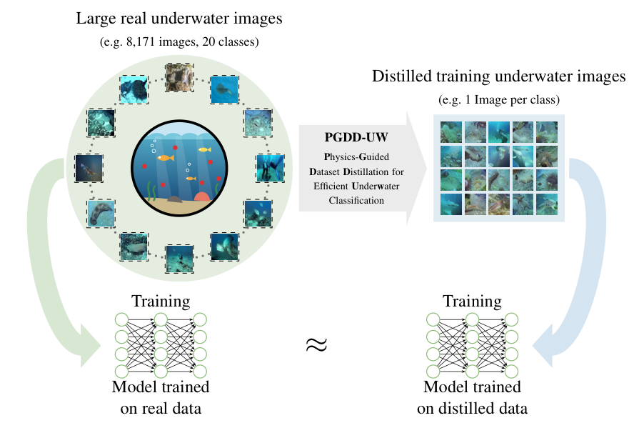
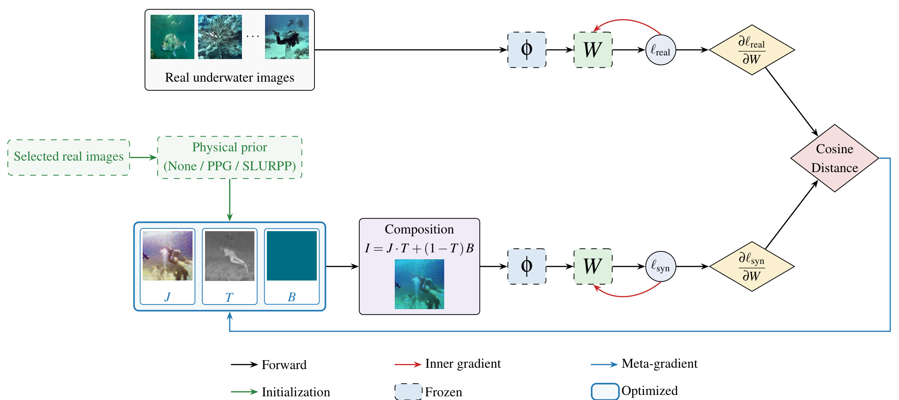
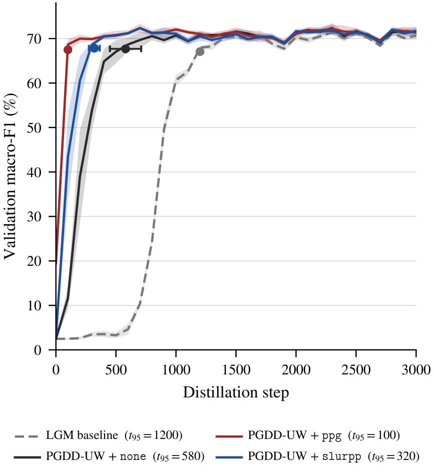

# PGDD-UW: Physics-Guided Dataset Distillation for Efficient Underwater Classification

**Alex Delaveau, Ayoub Karine, Camille Kurtz, Laurent Wendling**
Université Paris Cité, LIPADE, F-75006 Paris, France

*Accepted at VISAPP 2027.*

> [!NOTE]
> **Code release in progress.** The implementation, distillation scripts and evaluation protocol are being cleaned up and will be published in this repository shortly. Watch the repository to be notified.

<p align="center">
  
</p>

## Overview

Vision models embedded in autonomous underwater vehicles require domain-specific data that is costly to store, to train on and to transmit. Dataset distillation compresses such data into a small synthetic set. Since underwater degradation follows an explicit image formation model, we ask whether a physical prior helps dataset distillation.

PGDD-UW keeps the Linear Gradient Matching (LGM) objective unchanged and replaces the variables it optimizes. Instead of raw pixels, each synthetic image is composed from the three components of the underwater image formation model,

$$I = J \cdot T + (1 - T) \cdot B,$$

where $J$ is the scene radiance, $T$ the transmission map and $B$ the backscatter. The transmission and backscatter can be initialized from a physical prior (`none`, `ppg` from PA-Diff, or `slurpp` from SLURPP).

<p align="center">
  
</p>

## Main Findings

Experiments on **AQUA20** and **FishNet20** (20 fish families from FishNet), with self-supervised backbones (DINOv2, CLIP, MoCoV3) in the frozen-backbone, linear-probe regime:

- **In-domain:** on AQUA20, the reparameterization raises macro F1 by up to 4.5 points at 3 images per class. On FishNet20 the gain is slight.
- **Convergence:** on AQUA20, distillation converges up to twelve times faster than the LGM baseline.
- **Cross-backbone transfer:** the reparameterization degrades transfer to unseen backbones on both datasets. Initializing $T$ and $B$ from a restoration model recovers part of this loss.

<p align="center">
  
</p>

## Acknowledgements

This work was granted access to the HPC resources of IDRIS under the allocation 2026-AD011017762 made by GENCI.

We thank Azedine Mani, Head of the IT team (UFR Mathématiques et Informatique, Université Paris Cité), for his pivotal role in creating and making available computational resources essential to this work.

## Citation

If you find this work useful, please cite:

```bibtex
@inproceedings{delaveau2027pgdduw,
  title     = {{PGDD-UW}: Physics-Guided Dataset Distillation for Efficient Underwater Classification},
  author    = {Delaveau, Alex and Karine, Ayoub and Kurtz, Camille and Wendling, Laurent},
  booktitle = {Proceedings of the International Conference on Computer Vision Theory and Applications (VISAPP)},
  year      = {2027}
}
```

## Acknowledgements

This work was granted access to the HPC resources of IDRIS under the allocation 2026-AD011017762 made by GENCI.
